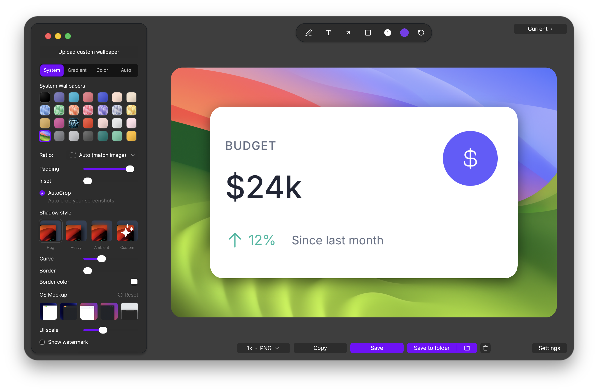
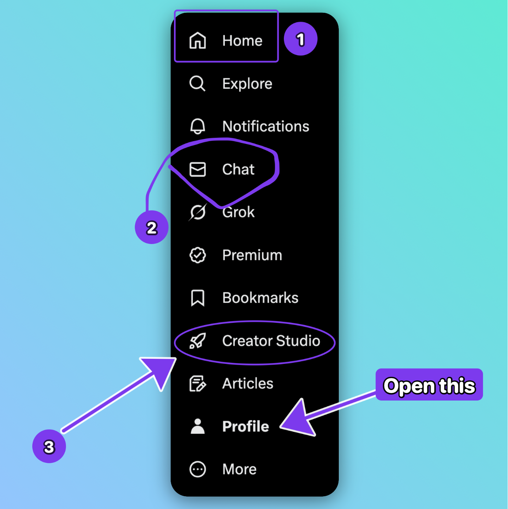
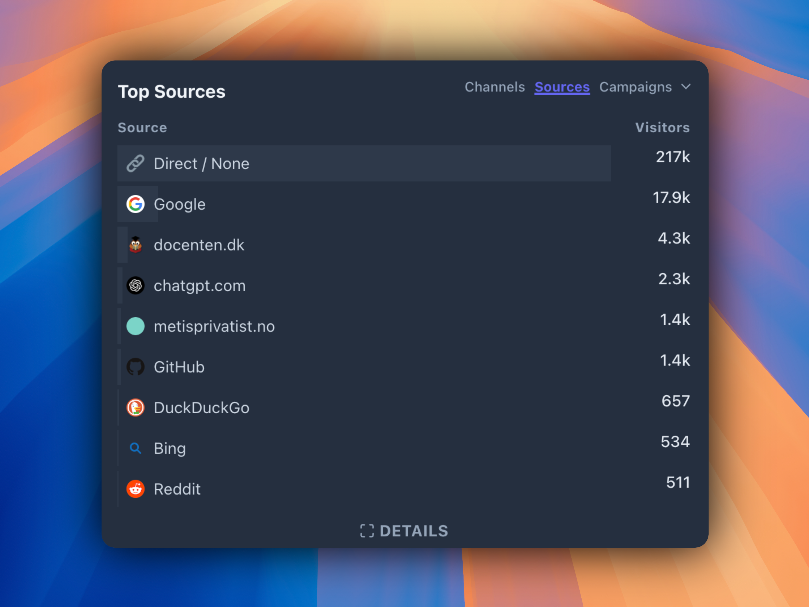

# shotify

<p align="center">
  
</p>

<h3 align="center">Screenshots, gently composed.</h3>

<p align="center">
  Capture, frame, annotate, and export presentation-ready screenshots in seconds.<br>
  An open-source, local-first desktop app built for <b>Linux</b>, <b>macOS</b>, and <b>Windows</b>.
</p>

<p align="center">
  <a href="https://lalitmukesh69.github.io/shotify/"></a>
  
  <a href="./LICENSE"></a>
  <a href="https://github.com/Lalitmukesh69/shotify/releases/latest"></a>
</p>

<p align="center">
  
</p>

---

## Overview

**shotify** is a native desktop app designed to streamline the screenshot workflow. Instead of snapping a raw capture and juggling three different apps to crop, frame, annotate, and clean it up, shotify handles the entire flow in one calm place.

- **100% Local & Private:** No cloud uploads, no external tracking, no accounts. Your images never leave your machine.
- **Cross-Platform:** Native support across Linux (Wayland & X11), macOS (Apple Silicon & Intel), and Windows (64-bit).
- **Fast & Lightweight:** Built on Tauri v2 and Rust for minimal memory footprint and instant startup.
- **Identical Preview & Export:** What you compose on the interactive canvas is pixel-for-pixel what gets copied or saved.

---

## Screenshots & Interface

### Live Editor Canvas
Frame your screenshots with system wallpapers, gradient harmonics, organic blur blobs, browser bars, and adjustable shadows.

<p align="center">
  
</p>

### Annotation Tools
Highlight key details with pens, arrows, boxes, ellipses, and numbered step badges.

<p align="center">
  
</p>

### Final Export Example
Generate polished assets ready for documentation, product launches, presentations, and social sharing.

<p align="center">
  
</p>

---

## Features

### 📸 Capture
- **Global Shortcuts:** Configurable system-wide hotkeys for instant regional, window, or fullscreen capture.
- **Direct Paste:** Paste an image directly from the clipboard (`Ctrl+V` / `Cmd+V`) into the editor.
- **Drag & Drop:** Drop any PNG, JPEG, or WebP into the canvas to frame existing images.

### 🎨 Framing & Composition
- **Backgrounds:**
  - System wallpaper autodetection
  - 30+ handcrafted harmonic gradients
  - Organic animated blob backdrops
  - Solid studio colors and custom image uploads
- **Window Mockups:**
  - macOS style window bar (traffic light controls)
  - Windows style header bar
  - Minimal / borderless clean frame
- **Spacing & Shadows:**
  - Slider controls for padding (16px – 96px)
  - Corner radius (0px – 32px)
  - Drop shadow depth, opacity, and soft diffusion
  - 3D perspective tilt (-6° to +6°)
- **Aspect Ratio Presets:** 16:9, 4:3, 1:1, Twitter/X header, auto-crop.

### ✏️ Annotation & Branding
- Smooth freehand drawing pen with color selection
- Precision geometric shapes (rectangles, circles, arrows)
- Numbered step badges (1, 2, 3...) for clear walkthroughs
- Watermark text with customizable position, opacity, and social badge prefixes

### 💾 Export & Sharing
- **Instant Clipboard Copy:** Copy high-res output directly to clipboard in one keystroke (`Ctrl+C` / `Cmd+C`).
- **Native File Dialog:** Save with standard OS file pickers.
- **Dedicated Folder Mode:** Automatically save sequentially to a designated screenshots directory.
- **Multi-Format:** Export to PNG, JPEG, or WebP with configurable scale factors (1x, 2x, 3x) and compression quality.
- **Auto-Close:** Optional preference to dismiss the editor automatically after copying or saving.

---

## Platform Support

| Platform | Compositor / OS Version | Capture Engine | Package Formats |
| :--- | :--- | :--- | :--- |
| **Linux** | Wayland (`hyprland`, `sway`, `niri`, `wlroots`, `gnome`, `kde`) & X11 | `grim` + `slurp` / XDG Desktop Portal (`ashpd`) / X11 fallback; clipboard via `wl-copy` & `xclip` | `.AppImage`, `.deb`, `.rpm`, `.tar.gz` |
| **macOS** | macOS 12+ (Apple Silicon & Intel x86_64) | Native CoreGraphics / ScreenCaptureKit | `.dmg`, `.app` |
| **Windows** | Windows 10 & 11 (64-bit) | Windows Graphics Capture / Win32 API | `.exe` (NSIS Installer) |

---

## Installation

### Prebuilt Binaries
Download the latest prebuilt binaries for your operating system from the **[Releases Page](https://github.com/Lalitmukesh69/shotify/releases/latest)**.

#### Linux
```bash
# AppImage (Make executable and run)
chmod +x shotify_*.AppImage
./shotify_*.AppImage

# Debian / Ubuntu (.deb)
sudo dpkg -i shotify_*_amd64.deb

# Fedora / RHEL (.rpm)
sudo rpm -i shotify-*.x86_64.rpm
```

*Note for Wayland users:* Ensure `grim` and `wl-clipboard` are installed on your distribution for optimal capture performance (`sudo apt install grim wl-clipboard` or `sudo dnf install grim wl-clipboard`).

#### macOS
Download the `.dmg` installer, open it, and drag **shotify** to your Applications folder.  
*First launch note:* If macOS warns that the app cannot be opened because it is from an unidentified developer, right-click the app in Finder and choose **Open**, or run:
```bash
xattr -rd com.apple.quarantine /Applications/shotify.app
```

#### Windows
Download `shotify_*_x64-setup.exe` and follow the setup wizard.

---

## Building from Source

### Prerequisites
1. **Node.js** (v18 or higher) and `npm`
2. **Rust** toolchain (v1.75+): Install via [rustup.rs](https://rustup.rs/)
   ```bash
   curl --proto '=https' --tlsv1.2 -sSf https://sh.rustup.rs | sh
   ```
3. **OS-specific dependencies**:
   - **Debian / Ubuntu**:
     ```bash
     sudo apt update && sudo apt install -y \
       build-essential \
       curl \
       wget \
       file \
       libssl-dev \
       libgtk-3-dev \
       libwebkit2gtk-4.1-dev \
       libayatana-appindicator3-dev \
       librsvg2-dev \
       grim \
       slurp \
       wl-clipboard
     ```
   - **Fedora**:
     ```bash
     sudo dnf install -y \
       webkit2gtk4.1-devel \
       openssl-devel \
       curl \
       wget \
       file \
       libappindicator-gtk3-devel \
       librsvg2-devel \
       grim \
       slurp \
       wl-clipboard
     ```
   - **macOS**: Xcode Command Line Tools (`xcode-select --install`).
   - **Windows**: Microsoft Visual Studio C++ Build Tools and WebView2.

### Build Steps

```bash
# 1. Clone the repository
git clone https://github.com/Lalitmukesh69/shotify.git
cd shotify

# 2. Install frontend dependencies
npm install

# 3. Run in development mode (hot-reloads UI and native Tauri shell)
npm run dev

# 4. Run automated test suite
npm test

# 5. Build production packages
npm run tauri:build
```

The compiled binaries will be placed in `src-tauri/target/release/bundle/`.

---

## Landing Page & Website

The official product landing page is located in [`landing/`](./landing/) and is hosted on GitHub Pages:

👉 **[https://lalitmukesh69.github.io/shotify/](https://lalitmukesh69.github.io/shotify/)**

To run the landing page locally:
```bash
python3 -m http.server 4173 --directory landing
```
Then navigate to `http://localhost:4173`.

Deployment to GitHub Pages is handled automatically on pushes to `main` via the [Deploy Landing Page](./.github/workflows/pages.yml) workflow.

---

## Project Structure

```text
shotify/
├── components/          # Shared React UI components & dialogs
├── docs/media/          # Screenshots, demo GIFs, and presentation assets
├── landing/             # Static website hosted on GitHub Pages
│   ├── index.html       # Official product landing page
│   ├── images/          # Web assets and icons
│   └── legal-pages/     # Privacy policy and terms
├── platform/            # Platform-specific build helpers (Linux/macOS/Windows)
├── src-tauri/           # Native Rust backend (Tauri v2)
│   ├── src/             # Screenshot pipeline, clipboard, shortcuts, platform hooks
│   ├── capabilities/    # Tauri permission configurations
│   ├── icons/           # High-resolution application icons
│   └── Cargo.toml       # Rust crate dependencies
├── tests/               # Vitest unit and integration test suite
├── ui/                  # Frontend canvas and editor application
├── .github/workflows/   # CI, GitHub Pages, and multi-platform release workflows
└── package.json         # Scripts and project metadata
```

---

## Contributing

Contributions, bug reports, and suggestions are welcome!

1. Fork the repository
2. Create your feature branch (`git checkout -b feature/amazing-feature`)
3. Run tests before committing (`npm test`)
4. Commit your changes (`git commit -m 'Add amazing feature'`)
5. Push to the branch (`git push origin feature/amazing-feature`)
6. Open a Pull Request

---

## License

This project is licensed under the **GNU General Public License v3.0 (GPL-3.0)** — see the [LICENSE](./LICENSE) file for details.

Portions derived from upstream [shot.style](https://github.com/webadderall/shot) are Copyright (c) 2026 shot.style and retain their original notice in [NOTICE](./NOTICE).
